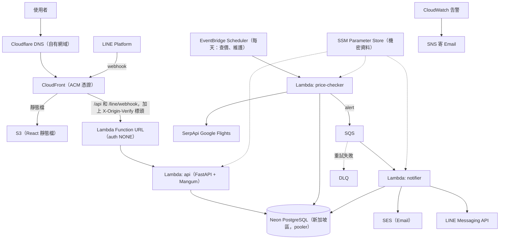

# FareWatch 最低價機票即時通知網站 — 架構規劃（依 SDLC 6 階段）

## Context
產品名稱 **FareWatch**（repo 資料夾為 `Project_TicketTrack`）。
使用者註冊帳號 → 設定航線／日期／目標價／航空公司 → 系統每天查價、累積價格歷史 → 價格**跌破目標價、低於 Google 典型價格區間，或創下歷史新低**時，發送站內通知 + Email；**有綁定 LINE 的使用者額外收到 LINE 推播**，訊息附訂票連結。
定位是**單人維護的展示型作品集**，**預算約每年 US$10（只有網域費用）**，同時涵蓋 前端／後端／API／Docker／CI/CD／k8s／AWS／DevOps，並依**軟體開發生命週期（SDLC）6 階段**組織。
本階段**不寫程式碼**，只產出架構文件。

## 文件狀態
- 目前為**草稿第 3 版**，已拆成本文件（總覽）和 6 份階段文件，並補上 Mermaid 圖
- 2026-10-09 審閱後已套用 12 項決策，見文末〈審閱決策紀錄〉
- 2026-10-10 第二次審閱後再套用 21 項決策，見文末〈第二次審閱決策紀錄〉
- 2026-10-10 M0 小實驗後改為只用 SerpApi，見文末〈M0 實驗決策紀錄〉
- 2026-10-20 SerpApi 小實驗確認來回票一次呼叫就夠，見文末〈M0 SerpApi 實驗紀錄〉

## 文件索引
| 階段 | 文件 | 內容 |
|---|---|---|
| 1 需求分析 | [01-requirements.md](01-requirements.md) | 已確定的決策、使用者故事、驗收條件、非功能需求 |
| 2 系統設計 | [02-design.md](02-design.md) | 技術選型、額度策略、觸發規則、帳號設計、資料模型、API、前端頁面 |
| 3 開發實作 | [03-development.md](03-development.md) | 專案結構、開發規範、M0～M4 實作順序 |
| 4 測試 | [04-testing.md](04-testing.md) | 測試金字塔、必測案例 |
| 5 部署 | [05-deployment.md](05-deployment.md) | 環境、CI/CD、回滾策略、成本控管 |
| 6 維運 | [06-operations.md](06-operations.md) | 監控告警、事件處理手冊、維護 |

## 系統架構圖
各條路徑的細節見[階段 2〈系統架構〉](02-design.md#系統架構正式環境)。

## 里程碑
| 里程碑 | 內容 |
|---|---|
| M0 | 前置驗證：Travelpayouts 小實驗（已完成，結論是不採用）、SerpApi 小實驗（已完成）、網域、DNS、SES 正式權限申請 |
| M1 | MVP 上線：帳號、追蹤、查價、站內通知與 Email、前端、Terraform 部署 |
| M2 | LINE 綁定與推播 |
| M3 | k8s（kind + Helm）與 Playwright E2E |
| M4 | 維運強化：完整監控、忘記密碼、LINE 登入、安全掃描 |

詳細步驟見[階段 3〈實作順序〉](03-development.md#實作順序依里程碑)。

---

## 審閱決策紀錄（2026-10-09）
| # | 問題 | 決定 |
|---|---|---|
| 1 | SerpApi 每日校準會超過 250 次／月 | 取消每日校準；SerpApi 只做確認 + 輪流巡檢，動態分配每日預算，嚴格限制在免費額度內 |
| 2 | 24 小時去重會讓使用者每天被通知；「低於平均」太常成立 | 狀態變化才通知；「便宜」改用 Google 典型價格區間下緣 |
| 3 | watch 和 price_query 沒有關聯 | `watches.price_query_id` FK；編輯時依 `query_hash` 重新對應 |
| 4 | 基準跨日期平均、混用不同供應商的價格 | 只比較同一個 price_query；基準來自 `price_insights` + 自己的 SerpApi 價格；Travelpayouts 只當雷達；目標價必填；累積 3 筆才判斷歷史新低 |
| 5 | SES 沙盒限制與預算 US$0 衝突 | 購買網域（約 US$10／年）+ SES；DNS 用 Cloudflare；Gmail SMTP 當備案 |
| 6 | Travelpayouts 對特定航線的覆蓋率未知 | M0 先做小實驗確認 |
| 7 | CloudFront OAC 會擋下 LINE webhook 的 POST | Function URL 公開 + CloudFront 加 `X-Origin-Verify` 密鑰標頭，由 middleware 驗證 |
| 8 | 同一個 image 跑 Lambda、本機、k8s | Lambda 基底 image；本機與 k8s 覆寫為 uvicorn；`buildx` 建 arm64 + amd64 |
| 9 | 出發日已過的追蹤仍會被查價 | 出發前 2 天停止查價；出發後自動 expired，前端收到歷史紀錄分頁 |
| 10 | LINE userId 不一致風險 | Login 與 Messaging API channel 建在同一個 Provider |
| 11 | 站內通知中心無法放系統訊息 | 拆成 `alerts`（業務紀錄）與 `notifications`（通知中心，支援 system 類型） |
| 12 | 單人開發範圍過大、上線太晚 | 分 M0～M4 里程碑，M1 即上線；新增唯讀示範帳號 |

## 第二次審閱決策紀錄（2026-10-10）
| # | 問題 | 決定 |
|---|---|---|
| 1 | Lambda 不接受 multi-arch image（修正上表第 8 項） | 改建單一架構 image：arm64 推 ECR 給 Lambda，amd64 只在本機和 CI 給 kind 用；build 加 `--provenance=false` |
| 2 | `record_low` 和 US-06 驗收條件矛盾 | 有狀態變化就通知；沒有狀態變化時三種原因共用「比上次通知再降 ≥5%」門檻；一筆價格只產生一則 alert |
| 3 | 新追蹤的初始狀態沒有定義 | 初始視為「高於」，第一次確認就符合條件會通知 1 次 |
| 4 | `query_hash` 沒有包含人數 | `price_queries` 加 `adults` 並納入 hash |
| 5 | 示範資料可能和真實查詢共用同一筆 price_query | `is_demo` 納入 hash |
| 6 | 公開註冊但 Email 驗證排在 M4，會傷害 SES 寄信信譽 | Email 驗證移到 M1；未驗證不能新增追蹤、不寄價格通知 |
| 7 | 沒有追蹤數上限，額度會被稀釋 | 每人 3 個追蹤、全站 20 個 active price_query；全站額滿時新追蹤排隊，暫不查價 |
| 8 | AWS 免費方案到期後帳號會被關閉；SES 不是永久免費 | 到期前升級成付費方案；成本說明補上 SES |
| 9 | Neon 免費版 point-in-time restore 視窗很短 | 資料救援以每週 `pg_dump` 為主 |
| 10 | SerpApi 本身有供應風險 | runbook 新增「SerpApi 停止服務」，靠 `PriceProvider` 介面換接 |
| 11 | 示範帳號「所有寫入回 403」會擋到登出 | 登出和 refresh 例外 |
| 12 | 彙總後的每日最低價沒有資料表；snapshot 刪除後 `alerts` 的 FK 失效 | 新增 `price_daily_lows`；`alerts.snapshot_id` 改為可 NULL |
| 13 | Context 開頭在講已作廢的舊文件；產品與 repo 名稱不一致 | 改成說明產品名稱 FareWatch 與 repo 名稱的對應 |
| 14 | 編輯追蹤後通知狀態沒有處理 | 編輯查價條件或目標價後重置 `watch_alert_states` |
| 15 | 「雷達顯示可能觸發」沒有定義 | 雷達價格 ≤ 目標價 × 1.05、低於典型區間下緣或歷史最低價；已通知過的要 ≤ 上次通知價 × 0.95 |
| 16 | Travelpayouts 可能不區分艙等和人數 | 併入 M0 小實驗確認，再決定是否限定經濟艙、單人 |
| 17 | refresh token cookie 沒有 CSRF 防護 | 加上 `Secure` 和 `SameSite=Strict` |
| 18 | 幣別沒有定義 | v1 一律 TWD |
| 19 | 公開端點沒有頻率限制，驗證信可能被濫發 | v1 不做，有需要再補；靠 SES 退信率／投訴率告警發現，處理方式寫進 runbook |
| 20 | 忘記密碼是否提前到 M1 | 維持 M4 |
| 21 | 降級期間「只用 Travelpayouts」和「只有 SerpApi 價格能觸發」互相矛盾 | 降級期間照發，但只限 `below_target`，並標註參考值；另外兩種原因暫停 |

## M0 實驗決策紀錄（2026-10-10）
實驗內容：對 TPE 出發到 NRT、KIX、ICN、BKK、SIN 共 5 條航線，測 30、60、120 天後出發的單程和來回（來回為 5 天後回程），呼叫 Travelpayouts 的 Aviasales Data API。腳本在 `experiments/m0/travelpayouts_probe.py`。

| 測試項目 | 結果 |
|---|---|
| 固定日期覆蓋率 | 30 個查詢只有 3 個有資料，各 1 筆 |
| 其中來回票 | 15 個全部沒資料 |
| 商務艙 | 5 條航線全部沒資料 |
| 整個月的最新價格（經濟艙單程） | 每條航線 7～18 筆，資料年齡從幾小時到約 7 天 |

| # | 問題 | 決定 |
|---|---|---|
| 1 | Travelpayouts 對台灣出發的固定日期查詢幾乎沒有資料，無法當雷達 | 不採用 Travelpayouts，只用 SerpApi |
| 2 | 雷達、確認、降級相關的設計失去前提 | 作廢上表第 15、16、21 項和 2026-10-09 第 1、4 項中關於 Travelpayouts 的部分；額度用完改為暫停查價 |
| 3 | 只靠 SerpApi 時額度更吃緊 | 來回票一次查價只算 1 次呼叫，訂票連結改用 Google Flights 網址；實作前用真實回應確認 |
| 4 | 「每 6 小時查價」不再成立 | 排程改為每天一次，各 query 依最久沒查的順序輪流查價 |
| 5 | 全站上限 20 個 query 時每個約 2.5 天才查一次（修正第二次審閱第 7 項） | 上限降為 8 個，每個 query 每天查一次；使用者是本人和極少數人，準確度和即時性優先於使用人數 |

## M0 SerpApi 實驗紀錄（2026-10-20）
實驗內容：TPE→NRT 來回、經濟艙、1 人，2026-12-19 出發、2026-12-24 回程，呼叫 1 次 SerpApi Google Flights。腳本在 `experiments/m0/serpapi_probe.py`。

| 測試項目 | 結果 |
|---|---|
| 航班選項 | best 4 筆、other 19 筆，每筆 `type` 為 Round trip |
| 價格是否為來回總價 | 是：最低一筆 10,372 TWD 等於 `price_insights.lowest_price`；每筆只列去程航段，回程要用 `departure_token` 再呼叫才看得到 |
| `price_insights` | 有：`lowest_price`、`price_level`（typical）、`typical_price_range`（6,400～12,500）、`price_history`（每天 1 筆，約 60 天） |
| 訂票連結 | `search_metadata.google_flights_url` 有值，帶入航線、日期、幣別與語系；手動開啟確認航線與日期正確 |
| 航空公司欄位 | `airline` 是中文名稱（例如「樂桃航空」），不是 IATA 代碼 |

| # | 問題 | 決定 |
|---|---|---|
| 1 | 來回票一次呼叫能否拿到總價（M0 實驗決策第 3 項的前提） | 成立：一次查價維持 1 次呼叫，全站上限 8 個 query 不變 |
| 2 | 歷史最低價冷啟動 | 確認 `price_history` 可用，照原設計當起點 |
| 3 | 依航空公司比對與顯示 | adapter 從 `flight_number` 或 `airline_logo` 取 IATA 代碼，不比對中文名稱 |
| 4 | 指定航空公司時 `price_insights` 是否仍會回傳 | 尚未測試；實作 adapter 時錄製 fixture 確認，沒有就照「沒有 `price_insights`」處理 |

---

## 驗證方式（文件階段）
- 確認 7 份文件涵蓋 6 個階段，Mermaid 圖在 GitHub 上能正常顯示
- 之後實作時，以[階段 1 的驗收條件](01-requirements.md#驗收條件範例)和[階段 4 的測試策略](04-testing.md)作為完成標準
